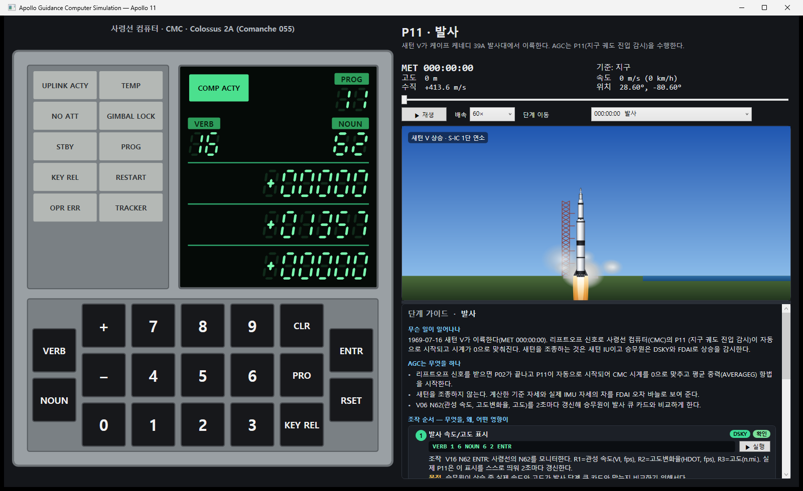
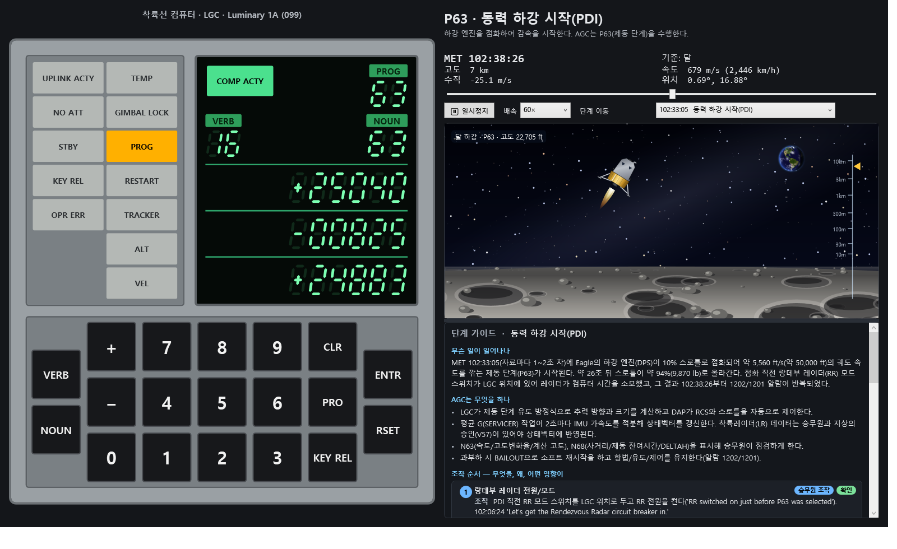

# AGC Simulation 개발 계획

Apollo Guidance Computer(AGC)의 DSKY를 시뮬레이션하고, 오른쪽 화면에서 Apollo 11의 발사→달 착륙→귀환 과정을 AGC와 연동해 보여주는 WPF 프로그램.

- 기술 스택: C# / .NET SDK 10 (`net10.0`, WPF는 `net10.0-windows`), MSTest 4
- 방식 결정: **B(시나리오 기반 시뮬레이션) + Apollo 11 단일 미션**으로 시작. 이후 A(실제 AGC ROM 에뮬레이션)로 확장할 수 있도록 CPU/미션 계층을 인터페이스(`ITelemetrySource`)로 분리한다.
- 개발 규칙: `CLAUDE.md`(주석, 중괄호, `_` 접두사, 매직 넘버 금지, 최소 로그 등) + **기능마다 자동 테스트를 함께 개발하고 실행해 통과를 확인한다.**

## 1. 화면 구성

| 영역 | 내용 |
|---|---|
| 왼쪽 절반 | DSKY(실제 Block II 배치): 램프 패널 2열×7행, 숫자 표시 5줄(COMP ACTY+PROG / VERB+NOUN / R1 / R2 / R3), 7열×3행 키패드 19키 (PC 키보드 매핑 지원) |
| 오른쪽 절반 | 미션 뷰: 단계명/설명, MET·고도·속도·수직속도·위치, 재생/일시정지, 배속, 타임라인 슬라이더, 단계 이동, **단계별 장면 렌더링**(발사·궤도·달 전이·하강·표면·재진입·착수 등 11가지, NASA 지구/달 텍스처 + 벡터 우주선), **단계 가이드 패널**(미션 설명, AGC 역할, 조작 순서와 목적·영향, [실행] 버튼). 장면과 가이드 사이는 스플리터로 크기 조절 |

키보드 매핑: 숫자(상단/넘패드), `+` `-`, `V`=VERB, `N`=NOUN, `Enter`=ENTR, `C`/`Backspace`=CLR, `R`=RSET, `K`=KEY REL, `P`=PRO.

### DSKY 실제 배치 (공개 자료 기준)

```
램프 패널 (2열 x 7행)            숫자 표시 (5줄, 녹색 전계발광 7-세그먼트)
 UPLINK ACTY | TEMP               [COMP ACTY]               PROG  [88]
 NO ATT      | GIMBAL LOCK        VERB [88]                 NOUN  [88]
 STBY        | PROG               ────────────────────────────────
 KEY REL     | RESTART            R1  [+/- 88888]
 OPR ERR     | TRACKER            ────────────────────────────────
   -         | ALT                R2  [+/- 88888]
   -         | VEL                ────────────────────────────────
                                  R3  [+/- 88888]

키패드 (7열 x 3행 = 격자 21칸 중 19키, 한 행을 2단위로 보았을 때)
              + 7 8 9 CLR
   VERB                       ENTR        <- VERB/NOUN, ENTR/RSET은 반 칸(1단위) 아래에서 시작해
              - 4 5 6 PRO                    3행 전체의 가운데에 걸친다
   NOUN                       RSET
              0 1 2 3 KEY REL
```

- 램프 색: 왼쪽 열(UPLINK ACTY, NO ATT, STBY, KEY REL, OPR ERR)은 흰색, 오른쪽 열(TEMP~VEL)은 호박색, COMP ACTY는 녹색. **색상은 사진 자료 기억에 근거한 가정이며 자료 대조가 필요하다.**
- 십진 표시 레지스터는 항상 `+`/`-` 부호가 붙고, 부호 칸이 공백이면 8진 표시(알람 코드 N09)이다.
- 키 격자의 세부(CLR/PRO/KEY REL이 6열, ENTR/RSET이 7열)는 "7열 3행 매트릭스, 19키, VERB/NOUN·ENTR/RSET이 반 칸 아래" 라는 공개 설명과 키 개수(2+3+9+3+2=19)로 맞춘 배치이다. 실제 사진과 최종 대조 필요.

## 2. 아키텍처

```
Agc.Core     (net10.0)          DSKY 로직, 텔레메트리 인터페이스, 로거
Agc.Mission  (net10.0)          Apollo 11 타임라인 데이터, 보간, 시뮬레이터(시계/배속/Seek/이벤트)
Agc.Wpf      (net10.0-windows)  UI: SegmentDisplay, DskyPanel, MissionIllustration(+Scene/: PlanetRenderer, SpacecraftArt, TerrainArt, StarField, SceneRenderer), PhaseGuidePanel, MainWindow
Agc.Tests    (net10.0-windows)  MSTest: 단위/연동/UI 렌더링 테스트
```

의존 방향: `Wpf → Mission → Core`, `Tests → 전부`.

연동 흐름:
1. `MissionSimulator`(= `ITelemetrySource`)가 MET를 진행시키고 현재 텔레메트리를 제공한다.
2. `DskyController`는 텔레메트리를 읽어 PROG 창을 채우고, V16 모니터 Noun 값을 갱신한다.
3. 시뮬레이터의 `AlarmRaised` 이벤트(1201/1202 등)를 `DskyController.RaiseAlarm`으로 전달해 PROG 램프를 켠다.
4. UI는 `DispatcherTimer`(50ms)로 `Advance → Update → RefreshView`를 반복한다.

### 지원하는 DSKY 명령

| Verb | 의미 | Noun |
|---|---|---|
| V35 | 램프 테스트(5초) | - |
| V06 | Noun 1회 표시 | 36 / 43 / 63 / 68 |
| V16 | Noun 연속 모니터 | 36 / 43 / 63 / 68 |
| V05 | 알람 코드 표시 | 09 |

Noun 정의는 **Luminary 099 소스(`PINBALL_NOUN_TABLES.agc`)** 를 따른다 (아래 "참고 자료" 참조).

| Noun | 원본 정의 | R1 | R2 | R3 |
|---|---|---|---|---|
| 09 | ALARM CODES (3COMP OCTAL ONLY) | 최근 알람(8진) | 이전 알람 | 그 이전 알람 |
| 36 | TIME OF AGC CLOCK (HMS) | 시 | 분 | 초×100 |
| 43 | LATITUDE / LONGITUDE / ALTITUDE | 위도 XXX.XX° | 경도 XXX.XX° | 고도 XXXX.X nm |
| 63 | ABS VALUE OF VELOCITY / ALTITUDE RATE / COMPUTED ALTITUDE | 속도 XXXX.X ft/s | 고도변화율 XXXX.X ft/s | 계산 고도 XXXXX. ft |
| 68 | SLANT RANGE TO LANDING SITE / TIME TO GO IN BRAKING PHASE / LR ALT − COMPUTED ALT | 사거리 XXXX.X nm | 제동 잔여시간 XXbXX(분 초) | 고도차 XXXXX. ft (모델링 안 함 → 0) |

- N68의 사거리는 현재 위치에서 착륙 지점(0.67°N, 23.47°E)까지의 대원 거리와 고도를 합성한 근사값, 제동 잔여시간은 다음 미션 단계까지의 시간이다.
- N62(속도 / 점화까지 시간 / 누적 ΔV), N60, N64 등은 아직 지원하지 않는다(M4).

### 로그 (최소 항목)

비동기 큐 + 전용 Writer(`AsyncFileLogger`), 실행 파일 옆 `logs/agc-yyyyMMdd.log`. UI 스레드는 파일 I/O를 기다리지 않는다.

| 시점 | 수준 |
|---|---|
| 앱 시작/종료 | INFO |
| 미션 단계 전환 (단계명, 프로그램 번호, MET) | INFO |
| DSKY 명령 실행 (V/N), V35 램프 테스트 | INFO |
| 프로그램 알람 발생 | WARN |
| OPR ERR (사유 포함) | WARN |

## 3. 마일스톤

| 단계 | 내용 | 상태 |
|---|---|---|
| M1 | 솔루션 뼈대, DSKY 로직(V35/V06/V16/V05, N09/36/43/63/68), Apollo 11 타임라인+시뮬레이터, 알람 연동, **실제 배치 DSKY UI**, 미션 뷰(벡터 도식), 비동기 로거, 테스트 하네스 | **완료** |
| M2 | 실제 동작 규칙 반영: **V/N 깜박임**, V35 세부(깜박임·종료 후 88 유지), V16 1초 갱신, 데이터 로드(V21~V25, 부호+5자리, N36 시계 설정), V33/V34, PRO 응답 규칙(로드 중 PRO 무시), KEY REL 램프(프로그램 표시 요청 충돌 시), **V37 프로그램 변경**(`IProgramControl`), 외관 정밀화(회색 베젤·우윳빛 램프·초록 라벨·기울어진 숫자) | **완료** |
| M2 잔여 | RESTART 램프(재시작 모델), 요청 표시를 실제 미션 시나리오에서 사용 | M4로 이월 |
| M3 | 화면 고도화: NASA 공개 텍스처(지구 Blue Marble, 달 LROC)를 구체로 렌더링(터미네이터·대기광·구름), 우주선(새턴 V/CSM/LM/캡슐)·지형·바다·플라스마 벡터 아트, 단계별 11가지 장면. 출처는 `doc/ASSETS_CREDITS.md` | **완료**(실제 아폴로 사진/영상 도입은 후속) |
| M3b | 단계 가이드 패널: 27개 단계의 미션 설명·AGC 역할·조작 순서(조작/목적/영향/확인 수준), 지원 DSKY 입력은 [실행] 버튼. 데이터는 doc/12 근거 | **완료** |
| M4 | 단계별 AGC 프로그램 시나리오: **(완료)** 사령선/착륙선 DSKY 전환(ALT/VEL 칸), 노운의 우주선별 정의(N62 CM/LM, N63/N68 LM 전용), 프로그램의 자동 표시(P11 N62, P63 N63)와 프로그램 표시 교체/KEY REL 보호. **(예정)** 점화 전 V06N62 카운트다운 자동 표시, N60/N64, 사령선 재진입 노운(N63 RTGO/VIO/TTE, N68), 1201/1202 시 깜박임·RESTART 램프, 랑데부(P20/P34/P35), 재진입(P61~P67) | **진행 중** |
| M5 | 타임라인 데이터 정확도 보정(Apollo 11 Flight Journal 대조), 다른 미션(Apollo 13 등) 확장 | 예정 |
| M6 | (선택) 실제 AGC ROM(Comanche/Luminary) 에뮬레이션 — CPU 계층 교체 | 예정 |

## 4. 알려진 한계 / 가정

- 타임라인 수치는 공개 기록을 바탕으로 한 **반올림 근사값**이며 실제 텔레메트리가 아니다 (코드 주석에도 명시). M5에서 보정한다.
- 같은 천체 기준 키프레임 사이는 선형 보간, 천체가 바뀌는 구간은 앞 값을 유지한다. 궤도 역학은 풀지 않는다.
- 오른쪽 장면의 지구/달은 NASA 공개 텍스처, 우주선·지형·바다·별은 코드로 그린 벡터이다. 실제 아폴로 사진/영상은 쓰지 않는다(출처·라이선스: `doc/ASSETS_CREDITS.md`).
- 장면의 우주선/지형 그림 코드는 비율 상수가 많아 CLAUDE.md 규칙 7(매직 넘버 금지)을 구역별 주석 수준으로만 지킨다. 상수화는 후속 정리 과제이다.
- 발사 장면의 고도는 이륙 직후가 비현실적으로 빠른 선형 보간을 피하려고 시각용 가속 곡선(고도 ∝ 시간^1.9)을 쓴다. 텔레메트리/DSKY 값은 타임라인 그대로이다.
- 알람은 공개 기록(Eyles, Flight Journal)에 따라 **1202 4회 + 1201 1회**이며 시각은 근사값이다(1202@102:38:26, 1202@102:39:02, 1201@102:42:17, 1202@102:42:41, 1202@102:42:57). 초기 구현의 알람 목록이 기록과 달라 수정했다.

## 5. 테스트 전략

### 하네스 구성 (`tests/Agc.Tests`)

| 구성 요소 | 위치 | 역할 |
|---|---|---|
| `FakeTelemetry` | `Harness/TestSupport.cs` | 값을 직접 바꿀 수 있는 텔레메트리 공급자 (DSKY를 미션과 분리해 테스트) |
| `ListLog` | 〃 | 로그를 메모리에 모아 로그 항목 검증 |
| `DskyDriver.Press("V16N63E")` | 〃 | 키 입력을 문자열로 재생 (`V N E C R K P + -` 및 숫자) |
| `[STATestMethod]` + `[DoNotParallelize]` | `Ui/` | WPF 컨트롤을 STA 스레드에서 생성/렌더링하고 `RenderTargetBitmap` 픽셀로 검증. XAML 로드 경합을 피하려 UI 테스트는 직렬 실행 |
| `InternalsVisibleTo("Agc.Tests")` | `Agc.Core.csproj` | 내부 변환 유틸(`DskyNouns`)을 직접 테스트 |

계층별 검증 방법:

1. **순수 로직(Core/Mission)**: 일반 단위 테스트. 경계값(99999 클램프, 구간 보간, 미션 끝 정지) 포함.
2. **연동**: 실제 `MissionSimulator` + `DskyController`를 이벤트로 연결해 PROG 창/모니터/알람 전달 검증.
3. **UI 렌더링**: OS 화면 캡처 대신 `RenderTargetBitmap`으로 컨트롤을 직접 렌더링해 픽셀로 확인 (OS 화면 캡처 신뢰 불가 이슈 회피). 육안 확인용 PNG를 임시 폴더(`%TEMP%\agc_dsky_panel.png`)에 저장.
4. **스모크**: 실제 `Agc.Wpf.exe`를 실행해 창 제목/응답/로그 기록/정상 종료 확인 (수동 절차 5.2).

### 5.1 실행 방법

```powershell
dotnet test tests/Agc.Tests          # 전체 테스트
dotnet test tests/Agc.Tests --filter "FullyQualifiedName~Dsky"   # 일부만
```

### 5.2 스모크 절차

1. `dotnet build AgcSimulation.slnx`
2. `src/Agc.Wpf/bin/Debug/net10.0-windows/Agc.Wpf.exe` 실행 → 창이 뜨고 5초 후에도 응답하는지 확인
3. 창 닫기 → `logs/agc-*.log`에 시작/종료 로그가 있는지 확인

### 5.3 테스트 케이스 목록 (M1~M4 일부, 코드리뷰 수정, UI·장면·가이드 확장: 총 300개, 모두 통과)

> UI 테스트 88개(UI-K/D/S/C/R/P/W 시나리오)의 **기능별 시나리오·절차·기대결과**와 최신 실행 결과는 엑셀 [`Test_Scenarios.xlsx`](Test_Scenarios.xlsx)에 정리했다(5.6). 아래 표는 클래스 단위 요약이다.

| 기능 | 테스트 클래스 (파일) | 개수 | 검증 내용 |
|---|---|---|---|
| Noun 표시 형식 | `DskyNounFormatTests` | 16 | 십진 항상 부호/5자리, 99999 클램프, 반올림, 8진 부호 공백, MIN/SEC(XXbXX), N36 시·분·초×100, N43 단위, N63 0.1 ft/s·ft 변환, N68, 미지원 Noun(N62 포함), 지원 Noun 판별 |
| 키 입력 상태기계 | `DskyEntryTests` | 12 | 초기 화면, PROG가 텔레메트리 추종, V/N 자리 입력, 재입력 시 지움, CLR, VERB 없는 숫자/3번째 숫자/미완성 ENTR/부호 키 → OPR ERR, RSET, PRO |
| DSKY 명령 실행 | `DskyCommandTests` | 22 | V35(전체 점등/5초 후 해제), V16 연속 갱신·COMP ACTY, V06 고정, N63·N68 값, 미지원 N62/N99/V99/V05N36/명령 누락 → OPR ERR, 실행 로그, KEY REL, 알람 램프/RSET, V05N09 최신순·최대 3개·즉시 갱신 |
| 미션 타임라인 | `MissionTimelineTests` | 17 | 빈/비증가 키프레임 예외, Duration, MET 클램프, 선형 보간, 천체 변경 구간 유지, 마지막 키프레임, 단계별 프로그램, 알람 정렬, 다음 단계까지 시간, 목표 없음/다른 천체/대원 거리 사거리 |
| 데이터 로드 | `DskyDataLoadTests` | 22 | V25N36 로드 시작·깜박임·빈 레지스터, 입력 중 표시, 3개 레지스터 로드로 시계 설정, 설정한 시계가 계속 흐름, 음수/분 범위/부호 없는 숫자/중복 부호/6번째 숫자/미완성 ENTR → OPR ERR, CLR, V21N36 거부, 로드 불가 Noun, V34 종료, V33 진행, VERB 키 중단, 로드 중 PRO 무시 |
| 프로그램/요청 표시 | `DskyProgramAndDisplayRequestTests` | 22 | V37(번호 대기·깜박임·NOUN 창 에코·요청 전달·거부·제어 없음·1자리 ENTR·NOUN 키 중단), V35 깜박임과 종료 후 88, KEY REL로 잔여 삭제, V16 1초 갱신, 깜박임 없음, 표시 요청(즉시/PRO 응답/입력 중 KEY REL 램프/모니터 중/KEY REL로 표시/미지원/V34) |
| Apollo 11 데이터 | `Apollo11MissionDataTests` | 12 | 시작 P11, 끝 195:18:35 착수, 값/설명 유효성, PDI=P63, 하강 고도 단조 감소, 착륙 102:45:40=P68·0m·0m/s, PDI 사거리 240~270 nm·착륙 시 0, PDI 제동 잔여 8분 27초, 알람 5개(1202×4+1201×1, 1201은 P64 이후)가 하강 프로그램 중 발생 |
| 시뮬레이터 | `MissionSimulatorTests` | 15 | 정지 시 무진행, 배속, 끝 도달 시 정지, Seek 클램프, Current 갱신, 알람 1회 발생/Seek는 미발생/여러 알람 순서(1202,1202,1201,1202,1202), 단계 전환 이벤트, 단계 로그, V37 요청(허용/거부/단계 전환 시 대체/같은 단계 유지) |
| 미션↔DSKY 연동 | `AgcMissionIntegrationTests` | 7 | PROG 창이 단계 추종, N36=MET, N63 하강 추적(고도 감소·하강률 음수), N68 사거리/잔여시간, 하강 알람 → PROG 램프 + V05N09 + RSET, V37E00E로 PROG 변경 후 다음 단계에서 복귀, 미지원 프로그램 거부 |
| 비동기 로거 | `AsyncFileLoggerTests` | 4 | Dispose 시 flush·레벨 표기, Dispose 이후 안전, 200줄 다중 스레드 무손실, NullLog |
| 키보드 입력 UI | `KeyboardMappingTests` | 14 | PC 키 → DSKY 키 매핑표(상단/넘패드 숫자, +/−, V/N/Enter/C/Backspace/R/K/P, Shift·Ctrl·Alt 처리, 미매핑 키, 19키 도달성), 창에서 키보드로 V35E·로드 입력, **실제 KeyDown 이벤트 라우팅(Handled)**, 마우스·키보드 혼용 |
| DSKY 조작 UI | `DskyOperationUiTests` | 18 | 마우스로 DSKY 조작한 종단 흐름: 초기 화면, V35E 전 과정(점등·깜박임·88 유지), V16 1초 갱신/V06 고정, OPR ERR/RSET, CLR, V37E00E, V25N36E 시계 로드, KEY REL, 미지원 명령 8종, V33/V34 응답, 범위 밖 시계 값, N43/N63/N68 값, 연속 명령 중 화면 형식 |
| 미션 컨트롤 UI | `MissionControlUiTests` | 16 | 초기 상태, 재생/일시정지, 배속 5종, 재생 중 배속 변경, 슬라이더 이동·범위, **모든 단계로 이동(시각·단계명·PROG·설명)**, 미션 끝 자동 정지, 텔레메트리 텍스트, 기준 천체 전환, 착륙지점 표시, 슬라이더 추종, 단계 목록 추종, 알람 연동, 도식 천체 색 |
| 복합 시나리오 UI | `CompositeScenarioUiTests` | 17 | **하강 전 과정(P63→P68, 알람 5회, 고도 단조 감소)**, 알람 읽기·해제·누적, V37 선택 후 단계 전환, 시계 로드+재생, 모니터 중 Seek, 재생 중 램프 테스트/로드, **3600× 전 미션 완주**, 모든 단계 N43 일치, 사거리·잔여시간 감소, 재생·일시정지 연속성, **무작위 키·시간·배속 스트레스 600회**, 알람 중간 재생, KEY REL, 로그 파일 기록, 이중 Dispose |
| 실제 창 UI | `RealWindowTests` | 6 | **창을 실제로 Show()**: 실제 타이머가 시계 진행, 깜박임·모니터가 각자 타이머로 동작, 주요 시나리오 **스크린샷 4장과 픽셀 검증**, 창 크기별(1500×860/1100×700/1920×1080) 레이아웃, 닫으면 타이머 정지, **실제 `Agc.Wpf.exe` 프로세스 실행 → PrintWindow 캡처 → 정상 종료(코드 0)와 시작/종료 로그** |
| 키 표기법 | `DskyKeyNotationTests` | 5 | 가이드의 키 문자열(V37E63E …) 파싱·검증·설명("VERB 1 6 NOUN 6 3 ENTR"), 컨트롤러 구동 |
| 미션↔DSKY 연결(자동 표시) | `AgcMissionLinkTests` | 8 | 발사 P11이 V16 N62를 스스로 표시, PDI에서 N63, 같은 단계 안의 Seek는 재표시 없음, 재생으로 점화를 지날 때 표시/KEY REL, 알람 전달, 도킹 후 사령선 노운 |
| 단계 가이드 데이터 | `PhaseGuideTests` | 7 | 27개 키프레임마다 가이드 1개, 설명·역할·조작 순서·참조, 단계마다 조작/목적/영향, 키 표기 유효성, **실행 가능(Runnable) 단계가 해당 단계에서 실제로 오류 없이 실행됨**, 하강 가이드의 N63/N68 |
| 우주선 전환 UI | `VehicleUiTests` | 10 | 사령선 DSKY의 ALT/VEL 칸 숨김, LM 분리/도킹 경계의 캡션·램프 전환, 모든 단계의 컴퓨터, 착륙선 램프 테스트 13개, 프로그램 자동 표시와 KEY REL 보호, N62 정의 차이(속도·고도 vs 점화 카운트다운), N63/N68은 착륙선 전용, 재생 중 컴퓨터 전환 2회 |
| 천체 렌더러 | `PlanetRendererTests` | 10 | NASA 텍스처 로드, 프레임/동결, 태양 쪽 밝기·바다 색, 지구 대기 글로/모서리 투명, 달 무채색·대기 없음, 면 전환, 구름 이동, 결정성, 렌더 속도, PNG 저장 |
| 미션 장면 | `SceneRenderingTests` | 14 | 키프레임별 장면 종류(11가지), 연소 구간의 엔진, 여정 비율, 발사 캡션(S-IC/S-II/S-IVB), **27개 단계 렌더링 + 스크린샷**, 발사 불꽃·푸른 하늘, 푸른 지구, 지구·달 동시 표시, 하강 지표·금색 착륙선, EVA 이후 성조기, 재진입 플라스마 강도, 낙하산·바다, 결정성, 장면당 렌더 시간 |
| 단계 가이드 패널 UI | `GuidePanelUiTests` | 9 | 모든 단계의 미션 설명·AGC 역할·조작 단계, 조작/목적/영향 표시, [실행] 버튼 수와 미지원 표시, **모든 [실행] 버튼이 DSKY에서 오류 없이 동작**, 단계가 바뀔 때만 다시 그림, 하강 가이드의 알람 설명, 레이아웃(1600×980/1100×700/1920×1080), 스크롤 |
| 메인 창 UI | `MainWindowUiTests` | 3 | 미션 끝에서 ▶를 누르면 처음부터 재생, 슬라이더 이동 시 단계 목록이 현재 단계를 가리킴, 같은 단계를 다시 골라도 이동 |
| DSKY UI | `DskyPanelUiTests` | 14 | V/N 깜박임 위상(깜박일 때만, 종료 시 복귀), 7-세그먼트 8>1·공백 무점등·`+`>`-`, 패널 Display 반영, 램프 색(흰/호박/녹), **램프 패널 2열×14칸 순서, 숫자 표시 5줄 순서, 키패드 19키 좌표(7열·반 칸 오프셋·중앙 정렬), 키가 정사각형**, 키→DskyKey 매핑, 버튼 포커스 미탈취, 렌더 픽셀 검증(값 유무에 따른 점등) |

### 5.4 개발 중 테스트로 발견·수정한 결함

| 결함 | 발견 경로 | 조치 |
|---|---|---|
| 정적 `SolidColorBrush`가 동결되지 않아 다른 스레드에서 컨트롤 생성 시 예외 | UI 테스트(STA 다중 스레드) | 공유 브러시를 `Freeze()` |
| 꺼진 `+` 세로 획이 모든 칸에 흐리게 그려짐 | 렌더 PNG 육안 확인 | 점등 시에만 그림 |
| UI 테스트 간헐 실패(`XamlParseException`) — MSTest 메서드 병렬 실행 중 XAML 동시 로드 경합 | 반복 실행(5회 중 1회 실패) | UI 테스트 클래스 `[DoNotParallelize]`, 이후 반복 실행 통과 확인 |
| 키가 정사각형이 아님(70×59) | 레이아웃 테스트 | 패널 높이 610→640→646(베젤 추가 후) |
| **하강 알람 데이터 오류**(코드 순서/시각 불일치, 4개였으나 실제는 5개) 및 P64/P66 고도·시각 | Eyles 문서·Flight Journal 대조 | 알람 5개(1202×4, 1201×1)로 수정하고 테스트로 고정 |
| DSKY 외관이 실제와 다름(어두운 본체, 흰 라벨, 직립 숫자) | Virtual AGC 실물 사진/도해 대조 | 밝은 회색 베젤, 우윳빛 램프, 초록 라벨 박스, 기울어진 숫자 |
| **코드리뷰 지적 10건**: ① 로드/V37 대기 중 `V33E`/`V34E`로 응답 불가(VERB 키가 대기를 취소) ② V34가 V16 모니터를 끄지 않음 ③ V35 중 입력이 숨은 상태를 남김(`887`) ④ 알람 핸들러가 갱신 전 MET를 봄 ⑤ 단계 콤보가 현재 단계와 동기화되지 않음 ⑥ 미션 끝에서 ▶가 동작하지 않음 ⑦ 경도 보간이 날짜 변경선을 무시 ⑧ 매직 넘버(CLAUDE.md 규칙 7) ⑨ 상수 중복 ⑩ 세그먼트 도형을 렌더마다 재생성 | 외부 코드리뷰 | 모두 재현 테스트 작성 후 수정. ①: VERB 키는 새 Verb 입력만 받고 ENTR 시 실행(V33/V34 이외는 대기를 대체) ②: V34가 모니터/표시 해제 ③: 램프 테스트 중 키 무시 ④: 이동 후 알림 ⑤⑥: MainWindow 수정 ⑦: 최단 경로 경도 보간 ⑧⑨⑩: 상수화·공용화·도형 캐시. CLR은 실제 DSKY처럼 데이터 입력에만 작동하므로 유지하고 주석으로 명시 |
| **N62를 잘못 정의**(속도/고도변화율/고도로 구현, 원본은 속도/점화까지 시간/누적 ΔV) 및 십진 레지스터 부호 누락 | 원본 소스 대조 | N63/N68로 교체, 십진은 항상 부호·8진만 공백으로 수정 |
| **최소 창 크기(1100×700)에서 "단계 이동" 콤보가 창 밖으로 잘림** | 실제 창 UI 테스트(UI-R04) | 고정 폭 StackPanel → 남는 폭을 채우는 Grid 열 |
| UI 테스트 하네스·시나리오 결함(시간 누적 오차, 기대값 오류, 램프 테스트 중 키 무시를 고려하지 않은 시나리오, 창 바깥 크기 기준 착오) | UI 테스트 실행 | 하네스·테스트 수정(제품 결함 아님). 전체 목록은 `Test_Scenarios.xlsx`의 "발견된 결함" 시트 |

### 5.5 이후 마일스톤의 테스트 규칙

- 새 기능은 해당 기능의 테스트(정상/경계/오류)를 **같은 변경에 포함**하고 `dotnet test` 전체 통과를 확인한 뒤 완료로 처리한다.
- 새 Verb/Noun → `DskyCommandTests`/`DskyNounFormatTests`에 케이스 추가, 새 단계/알람 → `Apollo11MissionDataTests`, UI 변경 → `DskyPanelUiTests` 렌더 검증 + 스모크 절차.
- 5.3 표의 개수/내용을 함께 갱신한다.
- 동작/표시 정의는 기억에 의존하지 않고 아래 공개 자료와 대조한 뒤 구현한다.
- UI 기능을 바꾸면 `tools/test_scenario_catalog.py`에 시나리오를 추가하고(테스트에 `[TestCategory("UI-...")]` 부여), 엑셀을 다시 만든다(5.6).

### 5.6 UI 테스트 하네스와 시나리오 엑셀

**하네스(`tests/Agc.Tests/Harness/UiDriver.cs`)**: 메인 창을 사람이 쓰듯 조작하고 화면을 읽는다.
- 마우스: `Click("VERB")`, `Press("V16N63E")`, 재생/배속/슬라이더/단계 이동
- 시간: 창을 띄우지 않는 테스트는 `Step`/`Run`(0.2초 단위, 정수 틱)으로 시간을 직접 흘린다. 창을 띄운 테스트(`Show()`)는 `Pump`로 실제 타이머가 돌게 한다.
- 읽기: PROG/VERB/NOUN/R1~R3 텍스트, 램프 점등, 깜박임, 미션 텍스트, `Capture()`(창 전체 비트맵)
- 검증 보조: `AssertDisplayWellFormed()`(모든 화면이 지켜야 할 형식 규칙)
- 제품 쪽 테스트 용이성: `MainWindow.Step`, `MainWindow.HandleKeyDown`, `DskyKeyboardMap`(키 매핑 분리), `InternalsVisibleTo`

**시나리오 엑셀(`doc/Test_Scenarios.xlsx`)**: 시트 4개 — 요약(수식), UI 시나리오 88개(분류: 단일/복합/실제 창/매핑표, 사전조건·절차·기대결과·자동화 테스트·결과), 전체 테스트 결과 218행, 발견된 결함 17건.

```powershell
python tools/make_test_report.py              # 전체 테스트를 실행하고 엑셀을 다시 만든다
python tools/make_test_report.py --trx x.trx  # 기존 TRX 결과로 만든다
```

스크린샷(실제 창 테스트가 `bin/.../screenshots/`에 저장): `doc/screenshots/` — 램프 테스트, 하강 중 알람, 착륙 후, 실행한 앱 전체 화면.





## 6. 참고 자료 (공개 자료)

| 용도 | 자료 |
|---|---|
| Noun/Verb 정의, 단위, 스케일 | Luminary 099 소스 `Luminary099/PINBALL_NOUN_TABLES.agc` — [chrislgarry/Apollo-11](https://github.com/chrislgarry/Apollo-11) (Virtual AGC 원본 소스 재게시) |
| DSKY 표시 구성(5줄), 램프 목록, 키 목록 | [NASSP: Display and Keyboard Assembly](https://nassp.space/index.php/DSKY) |
| 키패드 7열×3행 매트릭스 / VERB·NOUN·ENTR·RSET의 반 칸 오프셋 | [BleuLlama/USB_DSKY](https://github.com/BleuLlama/USB_DSKY) (3행 7열 스위치 매트릭스), [gkoch02/Idle-Hours PR #425](https://github.com/gkoch02/Idle-Hours/pull/425) ("VERB/NOUN and ENTR/RSET sit half a row lower ... as on the real DSKY") |
| 깜박임/PRO/KEY REL/PROG 램프 동작(M2 대상) | Apollo 15 Delco 소프트웨어 매뉴얼, LM-4.4 (LMA790-3) — [ibiblio.org/apollo](https://www.ibiblio.org/apollo/Documents/LMA790-3-LM-4.4.pdf), [Computers in Spaceflight Ch.2](https://www.nasa.gov/wp-content/uploads/static/history/computers/Ch2-7.html), [NASSP Simple AGC](https://nassp.space/index.php/C_AGC) |
| 미션 타임라인 보정(M5) | Apollo 11 Flight Journal, Apollo 11 Mission Report |
| DSKY 외관(실물 사진/도해) | Virtual AGC `AgcDskyCloseup.jpg`(Block II DSKY 사진), `ArtistDSKY.jpg`(도해: 초록 라벨 박스·기울어진 숫자·점등색), `compareDSKY.png`(램프 배열 비교) — https://www.ibiblio.org/apollo/yaDSKY.html |
| 하강 시퀀스(PDI~착륙, 알람, 실행 시각) | Eyles, "Tales from the Lunar Module Guidance Computer" — https://klabs.org/history/apollo_11_alarms/eyles_2004/eyles_2004.htm |
| **Virtual AGC 프로젝트 (종합)** | [ibiblio.org/apollo](https://www.ibiblio.org/apollo/) — [yaDSKY](https://www.ibiblio.org/apollo/yaDSKY.html)(DSKY 키/램프/표시 동작 설명, 도면·사진 목록), [Colossus 소스](https://www.ibiblio.org/apollo/Colossus.html), [Luminary 소스](https://www.ibiblio.org/apollo/Luminary.html), Verb/Noun 표 `yaAGC/Colossus249/ASSEMBLY_AND_OPERATION_INFORMATION.s`, 문서 라이브러리 [links2.html](https://www.ibiblio.org/apollo/links2.html), 엔지니어링 도면 `2003994-091.html`(Apollo 11-17 LM DSKY), `2003994-121.html`(CM DSKY), 색상 규격 `Documents/MIL_C_25050A.pdf` |

### 6.1 Virtual AGC에서 확인한 사실과 구현 반영 계획

| 확인한 내용 (출처: yaDSKY, index.html) | 현재 구현 | 계획 |
|---|---|---|
| 램프 14칸 구성. **CM(Apollo 8~)에는 ALT/VEL이 없고 LM(Apollo 11~14)에 ALT/VEL이 있다** | 한 가지 DSKY만 표시(ALT/VEL 포함) | M4: 미션 단계에 따라 CM DSKY(ALT/VEL 없음)와 LM DSKY(있음) 전환 — 하강/상승 단계는 LM, 나머지는 CM |
| 점등 색은 항공용 노랑/흰색(MIL-C-25050). 해당 램프의 노랑/흰색 구분은 도면 확인 필요 | 오른쪽 열 호박색, 왼쪽 열 흰색(가정) | 도면(`2003994-091.html`)과 색 규격 대조 |
| PROG 램프: 시작 시 프로그램 알람 보고에 사용, RSET이 램프를 끔 | 알람 시 PROG 점등, RSET으로 해제 (일치) | - |
| 십진은 부호 점등, 8진은 부호 소등 | 동일 (일치) | - |
| VERB/NOUN은 평소 점등, **사용자 입력이 필요할 때 깜박임** | 깜박임 없음 | M2: Flash 상태 추가 |
| V35E: 모든 램프 점등, 레지스터 +88888, **VERB/NOUN의 88은 깜박임**, 약 5초 후 종료(**종료 후 숫자는 남음**, STBY/RESTART는 점등 안 됨) | 5초 점등, 종료 시 원래 표시로 복귀, STBY/RESTART도 점등 | M2: 깜박임, 종료 후 값 유지 여부, STBY/RESTART 제외 검토 |
| V16N36E: R1 시, R2 분, R3 1/100초, **1초마다 갱신** | 50ms마다 갱신 | M2: 모니터 갱신 주기 1초로 변경 검토 |
| 데이터 로드(V21 등): 8진은 `+` 불필요, **십진은 `+`와 5자리 모두 필요**. CLR은 R1의 입력을 지움 | 미지원 (부호 키는 OPR ERR) | M2 |
| V37E 00E → P00 / PRO와 V33E는 다음 단계 진행 / KEY REL 램프는 새 모니터가 기존 모니터를 끊을 때 깜박임 | 미지원 | M2 |
| Luminary 시작 점검 순서: V35E → V37E00E → V25N01E ... | - | M2 이후 "체크리스트 모드" 시나리오 후보 |

참고: yaDSKY 설명의 "PROG 램프는 입력 대기 시 점등"은 Colossus/Luminary 프로그램 알람 동작과 표현이 달라 보인다. 구현은 알람 기준(위 표)으로 유지하되, M2에서 Delco 매뉴얼로 다시 확인한다.

주의: 이 단계에서 직접 확인한 것은 위 표의 Noun 정의(Luminary 099)와 DSKY 구성 설명이다. 램프 색상, 키 격자의 열 배정(CLR/PRO/KEY REL, ENTR/RSET의 열), M2 이후 동작 규칙의 세부는 **원본 도면/사진과 최종 대조가 필요한 가정**으로 남아 있다.
